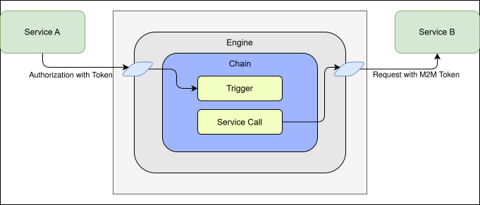
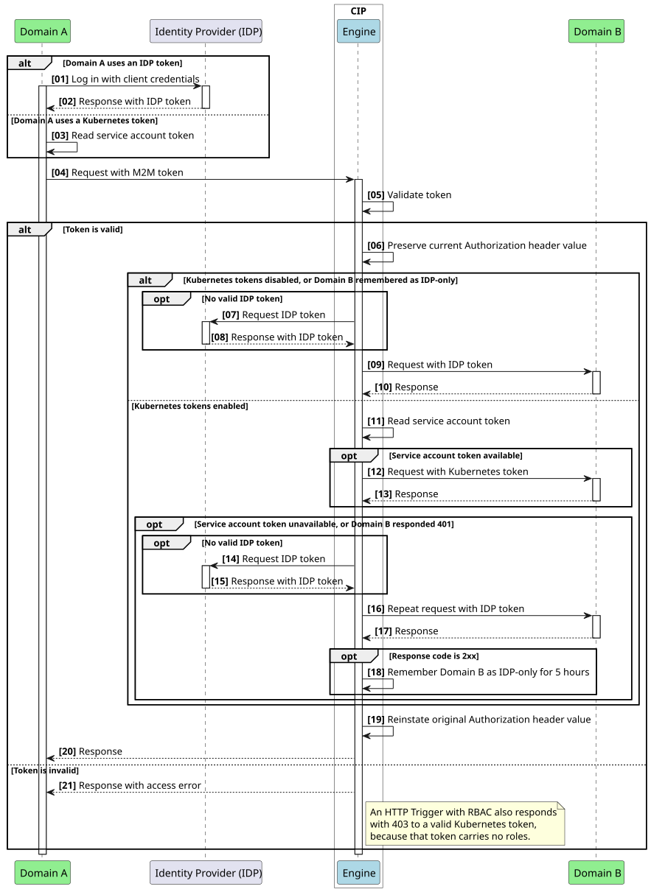

# Token Processing
## Description

---
Token mechanism allows secured communications between services and mitigates the risk of unrestricted access to the data. Each token that comes with the authentication request from service is going to be verified on two levels:

- **Engine Level:** on this level token is being validated via internal core libraries. This validation will ensure that token is correct and request is trusted. Only if authentication is successful, request is able to reach the chain (specifically the trigger element).
- **Trigger Level:** on this level tokenized request is being validated against the specified list of allowed roles (if any). This list could be filled under trigger's parameter tab.

The engine accepts a token issued by the Identity Provider (IDP). When the environment enables Kubernetes M2M authentication, it also accepts a Kubernetes service account token issued in its own namespace or in another namespace of the same composite deployment.

> ⚠️ A Kubernetes service account token carries no roles, so an HTTP Trigger with **RBAC** access control rejects a request with such a token with **403 Forbidden**.

In addition, Cloud Integration Platform provides the ability to pass the token as part of outgoing requests.
It is supported via option "**Enable M2M Security**" under the parameters tab for **HTTP Sender** and **GraphQL Sender** elements and "**M2M Token**" authorization option for **Service Call** element.
If mentioned options selected, then M2M token will be set to the **Authorization** header for outgoing request.
Before making a call with M2M token, system will preserve "current" value of Authorization header and reinstate it back after receiving the response (utilized M2M token itself will be completely erased from the system to avoid its leakage).
Please see the diagram below for the high-level process understanding.

**Diagram Description**

Diagram above shows common processing scheme, where token,
passed by Service A goes to the Engine (where it is going to be validated against the core libraries),
then token is going to be received by Trigger.
Trigger might have set of roles configured for additional validation (where for HTTP Trigger the system requires that at least one role must be defined if role-based access control is opted).
Service Call represents the element that is able to trigger the outbound call, if authorization option "**M2M Token**" is selected, then CIP Engine will put the M2M token to the **Authorization** header when calling Service B.

> ℹ️ There are 4 elements, that utilize mentioned security aspect, due to mechanism specifics:
>  [HTTP Trigger](../../01__Chains/1__Graph/1__Elements_Library/6__Triggers/1__HTTP_Trigger/readme.md)
>  [HTTP Sender](../../01__Chains/1__Graph/1__Elements_Library/7__Senders/4__HTTP_Sender/readme.md)
>  [GraphQL Sender](../../01__Chains/1__Graph/1__Elements_Library/7__Senders/7__GraphQL_Sender/readme.md)
>  [Service Call](../../01__Chains/1__Graph/1__Elements_Library/7__Senders/6__Service_Call/readme.md)

Please review the diagram below for detailed and sequential steps to understand how Cloud Integration Platform operates with the M2M tokens issued by the IDP and by Kubernetes.

**Diagram Details**

| #  | Step                                          | Description                                                                                                                                                                                                                                              |
|----|:----------------------------------------------|----------------------------------------------------------------------------------------------------------------------------------------------------------------------------------------------------------------------------------------------------------|
| 1  | Log in with client credentials                | Domain A authenticates in the Identity Provider (IDP) with its client ID and client secret.                                                                                                                                                              |
| 2  | Response with IDP token                       | The IDP responds with an M2M token.                                                                                                                                                                                                                      |
| 3  | Read service account token                    | Instead of steps 1 and 2, Domain A can use its Kubernetes service account token. The engine accepts it only when the environment enables Kubernetes M2M authentication.                                                                                  |
| 4  | Request with M2M token                        | Domain A sends a request to the engine with the token in the **Authorization** header.                                                                                                                                                                   |
| 5  | Validate token                                | The engine validates the token. A Kubernetes token must be issued in the engine's namespace or in another namespace of the same composite deployment. With a valid token the engine continues with step 6, and with an invalid one it ends with step 21. |
| 6  | Preserve current Authorization header value   | The engine stores the current value of the **Authorization** header before it sets the M2M token for the call to Domain B.                                                                                                                               |
| 7  | Request IDP token                             | Steps 7–10 run when sending Kubernetes tokens is disabled, or when Domain B is remembered as IDP-only (step 18). If the engine holds no valid IDP token, it requests one from the IDP with its own client credentials.                                   |
| 8  | Response with IDP token                       | The IDP responds with an M2M token.                                                                                                                                                                                                                      |
| 9  | Request with IDP token                        | The engine sends the request to Domain B with the IDP token.                                                                                                                                                                                             |
| 10 | Response                                      | Domain B performs the operation and responds.                                                                                                                                                                                                            |
| 11 | Read service account token                    | Steps 11–18 run instead of steps 7–10 when sending Kubernetes tokens is enabled. The engine reads its service account token issued for the `netcracker` audience.                                                                                        |
| 12 | Request with Kubernetes token                 | If the service account token is available, the engine sends the request to Domain B with it.                                                                                                                                                             |
| 13 | Response                                      | Domain B responds. For any response other than **401 Unauthorized**, an error response included, the engine continues with step 19.                                                                                                                      |
| 14 | Request IDP token                             | If the service account token is unavailable, or Domain B responded with **401 Unauthorized**, the engine gets an IDP token, as in steps 7 and 8.                                                                                                         |
| 15 | Response with IDP token                       | The IDP responds with an M2M token.                                                                                                                                                                                                                      |
| 16 | Repeat request with IDP token                 | The engine sends the same request to Domain B once more, with the IDP token.                                                                                                                                                                             |
| 17 | Response                                      | Domain B responds. The engine makes no further attempt.                                                                                                                                                                                                  |
| 18 | Remember Domain B as IDP-only                 | If the response code is 2xx, the engine remembers Domain B for 5 hours and sends its next requests with the IDP token straight away (steps 7–10).                                                                                                        |
| 19 | Reinstate original Authorization header value | The engine restores the original value of the **Authorization** header and removes the M2M token. Steps 6 and 19 ensure that the M2M token is not reused or exposed by later service calls within the chain.                                             |
| 20 | Response                                      | The engine sends a response to Domain A.                                                                                                                                                                                                                 |
| 21 | Response with access error                    | If the token fails validation, Domain A receives an error response. An HTTP Trigger with **RBAC** also responds with **403 Forbidden** to a valid Kubernetes token, because that token carries no roles.                                                 |

## Kubernetes Service Account Token

---

When the environment enables sending Kubernetes tokens (see [Configuration](#configuration)), **HTTP Sender**, **GraphQL Sender** and **Service Call** with the HTTP or GraphQL protocol send a Kubernetes service account token instead of the IDP token. Only requests with the M2M option selected are affected. Steps 11–18 of the diagram above show how the engine sends such a request and falls back to the IDP token.

The target service has to accept Kubernetes service account tokens for the first attempt to succeed. A target that does not accept them still receives the IDP token, at the cost of one extra request until the engine remembers it.

## Process Initialization

---

For incoming requests, process starts automatically, without additional manual user interference. As soon as login is done, system executes all necessary actions on the background. For outgoing requests, it is controlled by option **"Enable M2M Security"**, that could be selected for elements within the chain.

## User Interface

---
To enable sending **M2M token**, it is required to set option **"Enable M2M Security"** for [HTTP Sender](../../01__Chains/1__Graph/1__Elements_Library/7__Senders/4__HTTP_Sender/readme.md) or [GraphQL Sender](../../01__Chains/1__Graph/1__Elements_Library/7__Senders/7__GraphQL_Sender/readme.md) element
or select **"M2M Token"** authorization option for [Service Call](../../01__Chains/1__Graph/1__Elements_Library/7__Senders/6__Service_Call/readme.md) element.
Please, refer to the respective articles for more details.

## Data Storage

---

Please refer to [CIP Architecture](../../00__Overview/3__Architecture/readme.md) for global data storage information.

## Configuration

---

Global configuration steps are fully covered via environment parameters (before installation). Sending the Kubernetes service account token is controlled by the `HTTP_CLIENT_KUBERNETES_TOKEN_ENABLED` environment parameter. The default value is `false`, which keeps sending the IDP token only. For chain configuration or specific elements setup steps (including Role-based access control of endpoints for HTTP Trigger), please refer to the guide [Set Up Chain Availability Access Control](../../05__How_To/2__Set_Up_Chain_Availability_Via_Access_Control/readme.md).
